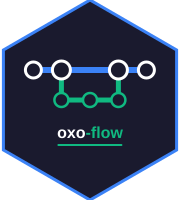

<div align="center">



<h1>oxo-flow</h1>

<p><strong>A Rust-native bioinformatics pipeline engine with AI Companion — built from first principles for performance, reproducibility, and developer experience.</strong></p>

[](https://github.com/Traitome/oxo-flow/actions/workflows/ci.yml)
[](https://github.com/Traitome/oxo-flow/releases)
[](https://crates.io/crates/oxo-flow-core)
[](https://bioconda.github.io/recipes/oxo-flow-cli/README.html)
[](rust-toolchain.toml)
[](https://traitome.github.io/oxo-flow/latest/)
[](#license)
[](https://doc.rust-lang.org/edition-guide/)
[](#quick-start)
[](https://github.com/Traitome/oxo-flow/releases)
[](https://anaconda.org/bioconda/oxo-flow-cli/files)
[](https://crates.io/crates/oxo-flow-cli)
[](https://github.com/Traitome/oxo-flow/stargazers)
[](https://deepwiki.com/Traitome/oxo-flow)

[Documentation](https://traitome.github.io/oxo-flow/latest/) · [Workflow Gallery](https://traitome.github.io/oxo-flow/latest/gallery/) · [Community](https://oxo-flow-community.github.io/) · [Roadmap](ROADMAP.md) · [Contributing](CONTRIBUTING.md) · [Security](SECURITY.md)

</div>

---

## What is oxo-flow?

oxo-flow is a high-performance bioinformatics pipeline engine built in Rust. It compiles workflows into Directed Acyclic Graphs and orchestrates execution with native concurrency, per-rule environment isolation, and AI-powered assistance — all from a single binary.

> 🧬 **Community:** browse curated, rated, ready-to-run workflows — ports of popular nf-core & Snakemake pipelines, original designs, and community submissions — at [oxo-flow-community](https://oxo-flow-community.github.io/).

- 🤖 **AI Companion & Scientist Team** — Grounded on deterministic engine APIs: natural language pipeline generation, intelligent refinement, 30+ domain diagnostic patterns, automated error recovery, and an opt-in Scientist Team multi-agent review profile. Powered by Claude, OpenAI, DeepSeek, or local Ollama.
- 🔀 **DAG-first engine** — Full static planning before compute: automatic dependency resolution, topological ordering, cycle detection, and target-driven (`-t`) minimal rule scheduling.
- 🛡️ **Physical resource & disk guards** — Multi-stage runtime disk-pressure guard (`min_free_disk` / `reclaim_free_disk` with cascade tombstone reclamation), global scratch directory isolation (`tmp_dir` / `OXO_FLOW_TMPDIR`), and concurrency-aware resource scheduling (CPU, memory, GPU, disk).
- 📦 **8 hermetic environment backends** — conda, mamba, pixi, docker, singularity, venv, system, and HPC modules — with per-rule isolation and an opt-in content-addressable store (`OXO_FLOW_ENV_STORE`) with automatic GC.
- 🔒 **Cryptographic reproducibility** — Execution truth anchored on SHA-256 output checksums, configuration fingerprints, and protected data tree audits (`protected_data_trees`), rejecting fragile file modification timestamps (`mtime`).
- ⚡ **Rust performance & safety** — Compiled zero-dependency native binary, instant startup, fearless concurrency with Tokio, and `#![forbid(unsafe_code)]` in every workspace crate.
- 🌐 **Modern Web Studio & Desktop shell** — Embedded React 19 SPA with interactive DAG canvas (React Flow + d3-dag), CodeMirror 6 TOML editor, and native desktop app (`oxo-flow-desktop`, wry + tao).
- 🧩 **First-party VS Code IDE** — `traitome.oxo-flow` extension published on both [Open VSX](https://open-vsx.org/extension/traitome/oxo-flow) and the [VS Code Marketplace](https://marketplace.visualstudio.com/items?itemName=traitome.oxo-flow): schema-driven completion, background diagnostics, canonical formatting, and one-click run/debug actions.
- 📊 **Clinical-grade reporting** — Deterministic HTML, JSON, Markdown, and PDF reports generated from checkpoint data; real tool QC metric parsing (fastp, STAR, bcftools, etc.), R-friendly TSV export (`--r-data`), and automated run snapshots.
- 🗄️ **Checkpoint & exact resume** — JSON-persisted execution state; resume interrupted workflows from the last completed rule without re-running verified steps.
- 🚀 **Three deployment modes** — Personal workstation, team server with OAuth2 (ORCID/GitHub), or HPC cluster submit panel — all from the exact same binary.

## Why oxo-flow?

| Feature | **oxo-flow** | Snakemake | Nextflow |
|---------|------------|-----------|----------|
| **Language** | Rust — compiled, type-safe, `#![forbid(unsafe_code)]` in the core, AI, CLI, and web crates | Python | Groovy/JVM |
| **Performance** | Native binary, instant startup | Python + JIT overhead | JVM startup overhead |
| **Workflow format** | TOML (`.oxoflow`) — declarative, composable | Snakefile (Python DSL) | Nextflow DSL (Groovy) |
| **Execution planning** | Pure DAG compiled & verified before compute; target-driven (`-t`) minimal subgraphs | Dynamic DAG evaluated by Python runtime | Dataflow channels dynamically wired at runtime |
| **Reproducibility model** | Cryptographic SHA-256 output checksums, config fingerprints, protected data tree audits | File modification timestamp (`mtime`), sensitive to clock/NFS drift | File timestamps + task hash cache (`.nextflow/cache`) |
| **Disk & scratch safety** | Built-in runtime disk-pressure guard (Hold/Reclaim ladder) + global `tmp_dir` scratch isolation | None — unhandled out-of-disk crashes; tools spill into system `/tmp` | Disk monitoring via Wave/Tower; no engine-level cascade reclamation |
| **Environment support** | 8 backends — conda, mamba, pixi, docker, singularity, venv, system, modules — per-rule | conda, singularity, docker | conda, docker, singularity, modules |
| **Web interface** | Built-in React 19 SPA + 100+ OpenAPI REST endpoints + SSE live events | External Snakemake-UI / panoptes | Nextflow Tower / Seqera Platform (commercial) |
| **Editor & IDE** | First-party VS Code IDE (Open VSX + VS Code Marketplace) & native desktop shell | Community editor plugins | Community editor plugins |
| **Reporting** | Built-in HTML/JSON/Markdown/PDF reports from checkpoint data + domain QC parser + `--r-data` TSV | Via MultiQC | Via Nextflow Tower / MultiQC |
| **Cluster backends** | SLURM, PBS, SGE, LSF | SLURM, PBS, SGE, LSF | SLURM, PBS, SGE, LSF, k8s, AWS Batch |
| **Security** | Shell sanitization, path traversal prevention, rate limiting | Limited | Limited |
| **AI Companion** | Architectural citizen — unified agent, 30+ domain diagnostic patterns, Scientist Team | Not built-in | Not built-in |
| **Testing** | 3,400+ tests (unit, integration, schema drift, AI eval) | pytest-based | Spock / varied |

## Design Principles (First Principles Thinking)

oxo-flow is built from first principles on six architectural pillars:

1. **DAG as Pure Declarative Data** — A workflow is mathematically a directed acyclic graph of pure data transformations, not an imperative script. All dependencies, wildcards, environments, and resource requirements are declared statically in `.oxoflow` TOML and validated before any job starts.
2. **Cryptographic Determinism over File Timestamps** — Reproducibility must be mathematically provable. oxo-flow anchors checkpoint state on SHA-256 output checksums, configuration fingerprints, content-addressable environment hashes, and protected data tree audits (`protected_data_trees`), rejecting fragile file modification timestamps (`mtime`).
3. **Hard Physical Boundaries & Resource Guards** — Real-world bioinformatics computation is constrained by physical limits: CPUs, GPUs, RAM, and finite disk volumes. oxo-flow enforces resource limits as first-class scheduling constraints, isolates scratch spaces via `tmp_dir`, and guards runs against out-of-space aborts through a multi-stage runtime disk-pressure ladder (Normal → Reclaim → Hold → Abort).
4. **Hermetic Environment Isolation** — Tool conflict is non-negotiable. Every rule names its isolated execution environment across 8 supported backends (conda, mamba, pixi, docker, singularity, venv, system, modules), with optional content-addressable deduplication.
5. **Rust-Native Performance & Safety** — Zero-cost abstractions, fearless concurrency with Tokio, and `#![forbid(unsafe_code)]` in every workspace crate ensure instant startup, minimal memory footprint, and reliable orchestration of tens of thousands of concurrent tasks without JVM or Python interpreter overhead.
6. **AI as an Architectural Citizen** — AI assistance is not a bolt-on chatbot; it is integrated directly into the engine's feedback loop. Machine-readable structured error codes (`{code, message, detail, suggestion}`), canonical TOML synthesis, 30+ domain diagnostic patterns, and the multi-agent Scientist Team allow AI to safely generate, audit, and self-heal workflows through deterministic engine APIs.

## Workflow Gallery

Learn oxo-flow incrementally with curated, validated example workflows — from a one-rule hello-world to production-grade pipelines. Every workflow passes `oxo-flow validate` and is tested in CI. See the [Workflow Gallery](https://traitome.github.io/oxo-flow/latest/gallery/) for the full catalog with detailed explanations, DAG visualizations, and CLI output.

## Quick Start

### Install from pre-built binaries

Download the latest release for your platform from [GitHub Releases](https://github.com/Traitome/oxo-flow/releases):

```bash
# Linux (x86_64)
curl -LO https://github.com/Traitome/oxo-flow/releases/latest/download/oxo-flow-latest-x86_64-unknown-linux-gnu.tar.gz
tar xzf oxo-flow-latest-x86_64-unknown-linux-gnu.tar.gz
sudo mv oxo-flow /usr/local/bin/

# macOS (Apple Silicon)
curl -LO https://github.com/Traitome/oxo-flow/releases/latest/download/oxo-flow-latest-aarch64-apple-darwin.tar.gz
tar xzf oxo-flow-latest-aarch64-apple-darwin.tar.gz
sudo mv oxo-flow /usr/local/bin/
```

### Install with cargo

```bash
cargo install oxo-flow-cli
```

### Install with Conda

```bash
conda install -c bioconda oxo-flow-cli
```

> **Version caveat** — the bioconda recipe can lag a freshly cut release
> while the bot recipe update lands. Check `conda search -c bioconda
> oxo-flow-cli` for the currently delivered version; if it is behind the
> release notes you need, install from the pre-built binaries above or
> `cargo install oxo-flow-cli` (crates.io).

### Run with Docker

Pre-built images are published to GitHub Container Registry on every release (and every push to `main`). Release images are multi-arch (`linux/amd64` + `linux/arm64`, so Apple silicon and ARM servers pull a native image). `:latest` moves only after the release image passes a health smoke test; a rolling `:<major.minor>` tag (e.g. `:0.19`) tracks the newest patch of each minor line, and `:main` is a multi-arch dev build from source:

```bash
# Web UI at http://localhost:3000 (CLI is inside the same image)
docker run -d --name oxo-flow -p 3000:3000 ghcr.io/traitome/oxo-flow:latest

# Pin a release (or track a minor line)
docker run -d -p 3000:3000 ghcr.io/traitome/oxo-flow:0.27.0
docker run -d -p 3000:3000 ghcr.io/traitome/oxo-flow:0.27

# CLI one-shot usage (workflow files mounted from the host)
docker run --rm -v "$PWD:/work" -w /work ghcr.io/traitome/oxo-flow:latest \
  oxo-flow run my-pipeline.oxoflow
```

Health endpoint: `GET /api/health` returns `"status":"ok"` when the database is reachable.

Container configuration is env-only: the image sets `OXO_FLOW_MODE=team`, `OXO_FLOW_HOST=0.0.0.0`, and `OXO_FLOW_PORT=3000` as defaults, and the CMD carries no CLI flags — so `docker run -e OXO_FLOW_PORT=9090 …` changes the actual bind port (the built-in healthcheck follows it). Note the published image is built **without** the `postgres` compile feature: pointing `DATABASE_URL` at a `postgres://` URL makes the container exit at startup (see the docker-compose.yml comment for how to build a feature-enabled image).

### Build from source

```bash
git clone https://github.com/Traitome/oxo-flow.git
cd oxo-flow
cargo build --release --workspace

# Build the web SPA so `oxo-flow serve` has assets to serve
# (the committed index.html references gitignored build output):
make frontend-build   # or: cd frontend && npm install && npm run build

# Install the CLI to your local cargo bin directory:
cargo install --path crates/oxo-flow-cli

# Binaries are in target/release/
# - oxo-flow        (CLI, includes `oxo-flow serve` for web UI)
# - oxo-flow-web    (Standalone web server)
```

Skipping the frontend build is safe: `oxo-flow serve` detects the missing
SPA assets and shows an actionable "SPA not built" page instead of a blank
screen.

### First workflow

```bash
# Create a new pipeline project (creates my-pipeline/ directory and my-pipeline.oxoflow)
oxo-flow init my-pipeline
cd my-pipeline

# Validate the workflow
oxo-flow validate my-pipeline.oxoflow

# Preview execution plan
oxo-flow dry-run my-pipeline.oxoflow

# Execute with 8 parallel jobs
oxo-flow run my-pipeline.oxoflow -j 8

# Visualize the DAG (use -f dot for Graphviz DOT output)
oxo-flow graph my-pipeline.oxoflow -f dot > dag.dot
dot -Tpng dag.dot -o dag.png

# Export a transit-map-style diagram via nf-metro
oxo-flow graph my-pipeline.oxoflow -f metro -o pipeline.mmd
# Render locally (requires nf-metro) or paste the .mmd content into the
# online playground: https://seqeralabs.github.io/nf-metro/latest/playground/
nf-metro render pipeline.mmd -o pipeline.svg

# Generate an HTML report
oxo-flow report my-pipeline.oxoflow -f html -o report.html
```

## Cluster / HPC

oxo-flow supports job submission to HPC cluster schedulers including SLURM, PBS/PBS Pro, SGE/UGE, and LSF. The `oxo-flow cluster` subcommand manages the full submission lifecycle.

```bash
# Submit a workflow to a SLURM cluster
oxo-flow cluster submit workflow.oxoflow --backend slurm --queue short -o jobs/

# Check submission status (no job ids: lists the user's jobs; --backend optional)
oxo-flow cluster status --backend slurm <job-id>
oxo-flow cluster status

# Cancel a submitted job
oxo-flow cluster cancel --backend slurm <job-id>
```

**Supported backends:** `slurm`, `pbs`, `sge`, `lsf`. Cluster submissions are configured inline via `oxo-flow cluster submit` flags.

Workflows can also carry reusable config supplements (e.g. per-cluster thread
and memory defaults) in `profiles/<NAME>.toml` next to the workflow:

```bash
# Run a workflow with a config supplement profile
oxo-flow run workflow.oxoflow --profile slurm
```

## Workflow Format (`.oxoflow`)

oxo-flow uses a TOML-based workflow format that is human-readable, composable, and declarative:

```toml
[workflow]
name = "variant-calling"
version = "1.0.0"

[config]
reference = "/data/ref/GRCh38.fa"

[[rules]]
name = "fastp"
input = ["raw/{sample}_R1.fastq.gz", "raw/{sample}_R2.fastq.gz"]
output = ["trimmed/{sample}_R1.fastq.gz", "trimmed/{sample}_R2.fastq.gz"]
threads = 8
shell = "fastp -i {input[0]} -I {input[1]} -o {output[0]} -O {output[1]}"

[rules.environment]
conda = "envs/fastp.yaml"

[[rules]]
name = "bwa_align"
input = ["trimmed/{sample}_R1.fastq.gz", "trimmed/{sample}_R2.fastq.gz"]
output = ["aligned/{sample}.bam"]
threads = 16
memory = "32G"
shell = "bwa-mem2 mem -t {threads} {config.reference} {input[0]} {input[1]} | samtools sort -o {output[0]}"

[rules.environment]
docker = "biocontainers/bwa-mem2:2.2.1"
```

Wildcards like `{sample}` expand automatically via input file discovery. Features include reference directory conventions, environment groups, optional rules, and directory inputs. See the full [Workflow Format Specification](https://traitome.github.io/oxo-flow/latest/reference/workflow-format/) for details.

## Editor Support (VS Code)

The first-party **oxo-flow Pipeline** extension (`traitome.oxo-flow`) makes VS Code a full `.oxoflow` IDE — and it is released in lockstep with the engine (VSIX with checksum attached to every GitHub release):

> **Note** — the extension is published to both marketplaces: [Open VSX](https://open-vsx.org/extension/traitome/oxo-flow) (searched by default by VSCodium, Cursor, Windsurf and most forks) and the [VS Code Marketplace](https://marketplace.visualstudio.com/items?itemName=traitome.oxo-flow) (stock VS Code, live since v0.27.0). Install from either, or grab the release VSIX offline:

```bash
codium --install-extension traitome.oxo-flow              # Open VSX (forks)
code --install-extension oxo-flow-vscode-v<version>.vsix  # offline VSIX (any VS Code)
```

It provides `[[rules]]`-aware syntax highlighting (wildcards and `{input[0]}` placeholders), completion and hover docs generated from the canonical workflow JSON Schema, background `validate`/`lint` diagnostics anchored to the failing rule, canonical formatting, and one-click run / dry-run / graph / resume / AI-generate commands. See the [VS Code Extension](https://traitome.github.io/oxo-flow/latest/reference/vscode-extension/) reference, or [Editor Setup](https://traitome.github.io/oxo-flow/latest/how-to/editor-setup/) for other editors (Zed, Helix, Neovim, JetBrains, …).

## CLI Commands

The `oxo-flow` binary provides **31 subcommands** covering the complete workflow lifecycle. See the full [CLI Reference](https://traitome.github.io/oxo-flow/latest/commands/run/) for details.

| Category | Commands |
|----------|----------|
| **Execution** | `run`, `resume`, `dry-run` (alias `plan`), `test`, `batch` |
| **Development** | `init`, `validate`, `format`, `lint`, `debug`, `template` |
| **Inspection** | `graph`, `info`, `report`, `status`, `config` (alias `check`), `diff`, `provenance`, `schema`, `verify-data` |
| **Environment** | `env`, `export`, `clean`, `touch` |
| **Deployment** | `serve`, `cluster`, `publish`, `pull` |
| **AI & System** | `ai`, `completions`, `license` |

See the full [CLI Reference](https://traitome.github.io/oxo-flow/latest/commands/run/) for detailed usage of each subcommand.

## Web API

The `oxo-flow serve` command starts an [axum](https://github.com/tokio-rs/axum)-powered REST server with **100+ endpoints** across 9 domains (workflow, execution, dag, AI, auth, collaboration, observability, chat, clusters). Full API reference at the [Web API reference](https://traitome.github.io/oxo-flow/latest/reference/web-api/) (`GET /api/openapi.json` serves the live OpenAPI 3.1 spec).

## Architecture & Workspace Layout

oxo-flow is organized as a Cargo workspace with four crates, plus a fifth
(`oxo-flow-desktop`) that lives in `crates/` but is excluded from the
workspace so headless builds never need GUI toolchains:

```
oxo-flow/
├── crates/
│   ├── oxo-flow-core/     # Core library: DAG engine, executor, environment mgmt,
│   │                      # config parsing, scheduler, wildcard expansion, reporting
│   ├── oxo-flow-ai/       # AI companion: provider abstraction, skill system, agents
│   ├── oxo-flow-cli/      # CLI binary ("oxo-flow") — Clap-based, 31 subcommands
│   ├── oxo-flow-web/      # Web server ("oxo-flow-web") — axum REST API + frontend
│   └── oxo-flow-desktop/  # Native desktop shell ("oxo-flow-desktop", wry + tao) —
│                          # excluded from the workspace (own Cargo.toml)
├── editors/
│   └── vscode/            # First-party VS Code IDE extension (traitome.oxo-flow)
├── frontend/              # Modern React 19 + TypeScript + Vite web workspace
├── examples/              # Example .oxoflow workflows
├── tests/                 # Integration tests
└── docs/                  # Documentation (MkDocs)
```

| Crate | Type | Binary | License |
|-------|------|--------|---------|
| `oxo-flow-core` | Library | — | Apache-2.0 |
| `oxo-flow-ai` | Library | — | Apache-2.0 |
| `oxo-flow-cli` | Binary | `oxo-flow` | Apache-2.0 |
| `oxo-flow-web` | Binary | `oxo-flow-web` | Dual Academic / Commercial |
| `oxo-flow-desktop` | Binary | `oxo-flow-desktop` | Apache-2.0 |

### Key modules

| Module | Crate | Responsibility |
|--------|-------|----------------|
| `dag.rs` | core | DAG construction, validation, topological sort |
| `executor/` | core | Task execution (local, cluster, cloud), checkpointing, staging |
| `environment.rs` | core | Environment management (conda, mamba, pixi, docker, singularity, venv, system, modules) |
| `config/` | core | Workflow configuration and `.oxoflow` file parsing |
| `rule.rs` | core | Rule/step definitions with inputs, outputs, shell, resources |
| `scheduler.rs` | core | Job scheduling with resource constraints |
| `wildcard.rs` | core | Wildcard pattern expansion (`{sample}`, `{chr}`, etc.) |
| `report.rs` | core | Modular report generation (HTML, JSON, PDF via wkhtmltopdf) |
| `format.rs` | core | Workflow formatting, linting, and 30+ diagnostic patterns |
| `plugin.rs` | core | Plugin system for MCP servers and custom tools |
| `ai_provider.rs` | web | Multi-provider AI abstraction (Claude, OpenAI, DeepSeek, Ollama) |
| `domains/ai/` | web | AI translation, chat SSE streaming, agent orchestration |
| `domains/execution/` | web | Run lifecycle, diagnostics, pause/resume, retry |
| `domains/workflow/` | web | Pipeline CRUD, validation, DAG building, templating |
| `provider.rs` | ai | Multi-provider AI client abstraction with auto-detection |
| `skill.rs` | ai | Skill registry and discovery system |
| `agent/` | ai | Agent orchestration and tool-calling framework |
| `mcp.rs` | ai | MCP (Model Context Protocol) server integration |

## Three-Mode Deployment

`oxo-flow serve` starts the web interface with an embedded REST API and React SPA. Run it without arguments for local experimentation:

```bash
# Mode 1: Personal workstation (default) — SQLite, localhost:8080, no auth
oxo-flow serve
# → Open http://127.0.0.1:8080 in your browser

# Mode 2: Team server — multi-user (env-var passwords + optional ORCID/GitHub OAuth2)
oxo-flow serve --mode team --host 0.0.0.0

# Mode 3: HPC submit panel — the scheduler (SLURM/PBS/SGE/LSF) is probed at
#   startup when the server itself runs on a cluster login node
oxo-flow serve --mode hpc
```

Serve flags: `--mode` (`personal` | `team` | `hpc`), `--host` (default
`127.0.0.1`), `-p`/`--port` (default `8080`), `--base-path`, and `--open`
(open the browser on startup). Each flag also has an `OXO_FLOW_*`
environment-variable form, plus a platform config file layer — see
[Deployment Modes](docs/guide/src/how-to/deploy-modes.md).

**PostgreSQL:** both `oxo-flow serve` and the standalone `oxo-flow-web`
binary read the `DATABASE_URL` environment variable — a `postgres://` URL
(on a build with the `postgres` feature) enables the PostgreSQL backend for
the library/AI/auth domains; the default (`sqlite://oxo-flow.db` in the
working directory) stays SQLite. Note that the published Docker image is
built WITHOUT the `postgres` feature — rebuild with
`cargo build --features postgres` to enable it. Run execution stays
SQLite-only either way: on a PostgreSQL server every `/api/runs*` endpoint
answers `503 RUNS_REQUIRE_SQLITE`.

## Documentation

Full documentation is available at **[traitome.github.io/oxo-flow/latest/](https://traitome.github.io/oxo-flow/latest/)**.

### 📖 Documentation Quick Links

| If you are... | Recommended Start |
|---|---|
| **New to oxo-flow** | [Quick Start](https://traitome.github.io/oxo-flow/latest/tutorials/quickstart/) · [First Workflow](https://traitome.github.io/oxo-flow/latest/tutorials/first-workflow/) |
| **A Bioinformatician** | [Workflow Gallery](https://traitome.github.io/oxo-flow/latest/gallery/) |
| **A Pipeline Engineer** | [Workflow Format Specification](https://traitome.github.io/oxo-flow/latest/reference/workflow-format/) · [CLI Reference](https://traitome.github.io/oxo-flow/latest/commands/run/) |
| **A DevOps/Cloud Admin** | [Environment Management](https://traitome.github.io/oxo-flow/latest/tutorials/environment-management/) · [Running on Cluster](https://traitome.github.io/oxo-flow/latest/how-to/run-on-cluster/) |
| **A Bioinformatics Core** | [Workflow Gallery](https://traitome.github.io/oxo-flow/latest/gallery/) · [Environment Management](https://traitome.github.io/oxo-flow/latest/tutorials/environment-management/) |

MkDocs source lives under [`docs/guide/src/`](docs/guide/src/).

## Development

```bash
# Build all workspace crates
cargo build --workspace

# Run all tests (unit + integration)
cargo test --workspace

# Run the full CI suite (fmt + clippy + build + test + schema-drift + version-check + audit + frontend lint)
make ci

# Individual CI steps
cargo fmt -- --check                             # Check formatting
cargo clippy --workspace --all-targets -- -D warnings  # Lint (zero warnings)
cargo build --workspace                          # Compile
cargo test --workspace                           # Test

# Format code
cargo fmt
```

> A bare `cargo build` at the repo root builds only the root `oxo-flow`
> library package (the integration-test crate) — not the CLI or web
> binaries. Pass `--workspace` whenever you want `target/*/oxo-flow` and
> `target/*/oxo-flow-web`.

### Tech stack

| Component | Technology |
|-----------|------------|
| Language | Rust (2024 edition) |
| Async runtime | [tokio](https://tokio.rs/) |
| CLI framework | [clap](https://github.com/clap-rs/clap) (derive) |
| Web framework | [axum](https://github.com/tokio-rs/axum) |
| Serialization | [serde](https://serde.rs/) + TOML |
| Graph library | [petgraph](https://github.com/petgraph/petgraph) |
| Templating | [tera](https://github.com/Keats/tera) |
| Error handling | [thiserror](https://github.com/dtolnay/thiserror) (lib) / [anyhow](https://github.com/dtolnay/anyhow) (bin) |
| Logging | [tracing](https://github.com/tokio-rs/tracing) |

## License

This project uses a **split licensing model**:

| Crate | License | Details |
|-------|---------|---------|
| `oxo-flow-core` | [Apache-2.0](LICENSE) | Free and open-source |
| `oxo-flow-ai` | [Apache-2.0](LICENSE) | Free and open-source |
| `oxo-flow-cli` | [Apache-2.0](LICENSE) | Free and open-source |
| `oxo-flow-web` | [Academic](LICENSE-ACADEMIC) / [Commercial](LICENSE-COMMERCIAL) | Free for academic and non-commercial use; commercial use requires a separate license |

The core library, AI companion, and CLI are licensed under the **Apache License 2.0** — you are free to use, modify, and distribute them without restriction.

The **web interface** (`oxo-flow-web`) is available under a **dual license**: free for academic and non-commercial use under the Academic License, and requiring a commercial license for commercial deployments. See [LICENSE-ACADEMIC](LICENSE-ACADEMIC) and [LICENSE-COMMERCIAL](LICENSE-COMMERCIAL) for details.

## Contributing

Contributions are welcome! Please see:

- [CONTRIBUTING.md](CONTRIBUTING.md) — Contribution guidelines
- [ROADMAP.md](ROADMAP.md) — Project roadmap and areas where help is needed
- [CODE_OF_CONDUCT.md](CODE_OF_CONDUCT.md) — Community standards
- [GOVERNANCE.md](GOVERNANCE.md) — Project governance and decision-making
- [SECURITY.md](SECURITY.md) — Security vulnerability reporting

Before submitting a PR, ensure all checks pass:

```bash
make ci
```

## Citing

If you use oxo-flow in academic research, please cite:

> **Shixiang Wang**, *oxo-flow: compiled, memory-safe bioinformatics workflow orchestration*, bioRxiv, 2026, [https://doi.org/10.64898/2026.06.11.731578](https://doi.org/10.64898/2026.06.11.731578)
>
> Jia Ding, Yun Peng, Ruochen Wei, Boquan Wang, Jian-Guo Zhou, **Shixiang Wang**, *BLIT: an R package for seamless integration of command-line bioinformatics tool universe*, Bioinformatics Advances, Volume 6, Issue 1, 2026, vbag088, [https://doi.org/10.1093/bioadv/vbag088](https://doi.org/10.1093/bioadv/vbag088)

## Community

- **Bug reports** — [GitHub Issues](https://github.com/Traitome/oxo-flow/issues) (use [bug report template](.github/ISSUE_TEMPLATE/bug_report.md))
- **Feature requests** — [GitHub Issues](https://github.com/Traitome/oxo-flow/issues) (use [feature request template](.github/ISSUE_TEMPLATE/feature_request.md))
- **Documentation** — [traitome.github.io/oxo-flow/latest/](https://traitome.github.io/oxo-flow/latest/)
- **Questions** — [Ask DeepWiki](https://deepwiki.com/Traitome/oxo-flow)

### 🧪 Real-World Feedback

oxo-flow aims to work reliably across diverse computing environments — laptops, HPC clusters, GPU nodes. We cannot replicate every deployment scenario in CI. If you use oxo-flow, please share your experience (success or failure) as a [GitHub Issue](https://github.com/Traitome/oxo-flow/issues) with the prefix `[Real-World Testing]`. Your feedback directly shapes our priorities.

## Additional Resources

- [LIMITATIONS.md](LIMITATIONS.md) — Known limitations and constraints
- [REPRODUCIBILITY.md](REPRODUCIBILITY.md) — Reproducibility guarantees and methodology
- [RELEASING.md](RELEASING.md) — Release process and versioning policy
- [TRADEMARK.md](TRADEMARK.md) — Trademark usage guidelines
- [docs/CHANGE_CONTROL.md](docs/CHANGE_CONTROL.md) — Change control for regulated environments
- [docs/VALIDATION_PROTOCOL.md](docs/VALIDATION_PROTOCOL.md) — IQ/OQ/PQ validation protocol

---

<div align="center">

**Built with 🧬 by [Traitome](https://github.com/Traitome)**

</div>

---

## Contributors

Thanks goes to these wonderful people:

<a href="https://github.com/ShixiangWang"></a>
<a href="https://github.com/andrewbudge"></a>
<a href="https://github.com/mugpeng"></a>

> Run `make contributors` to refresh the contributor list from git history.
