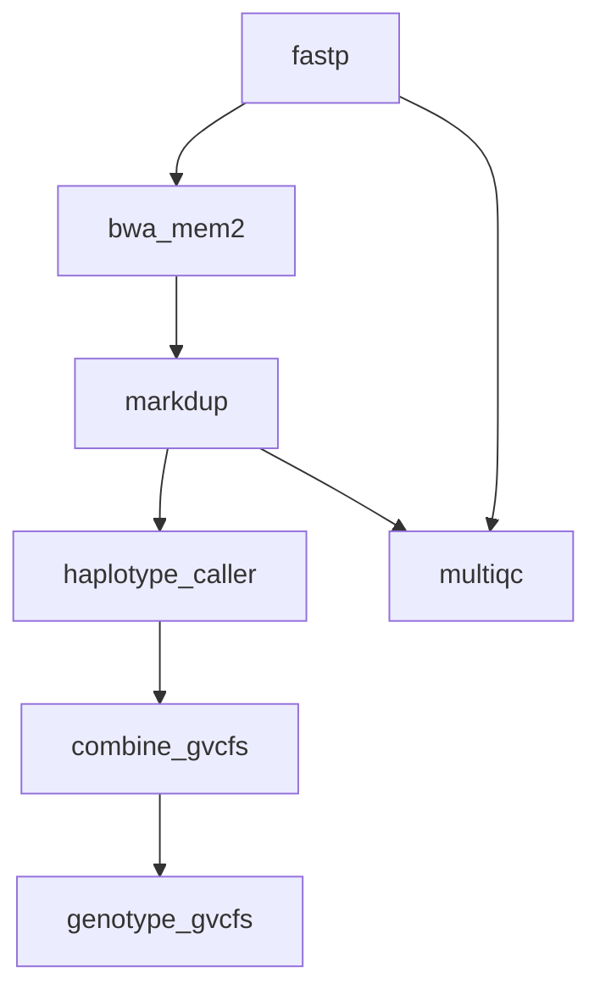

# 12 — Cohort Analysis with Sample Groups

A population-scale study: multiple `[[sample_groups]]` expand per-sample instances, the per-sample GVCFs are gathered and joint-genotyped as one cohort, and a single multiqc aggregation step consumes the whole cohort's QC directory.

## What It Demonstrates

- `{sample}` rules expand once per sample across all groups (case/control here)
- Cohort-level joint genotyping: `combine_gvcfs` gathers every per-sample GVCF via `expand_inputs` (`config.samples_list`), and `genotype_gvcfs` calls the whole cohort in one pass
- The aggregation rule has no wildcard inputs → exactly one instance; `depends_on` keeps it behind every per-sample instance of the referenced rules (a template name expands to all its instances; the multiqc rule consumes the QC directory itself, which edge inference links to every producer writing under it)
- Per-rule conda environments keep tool versions isolated (fastp / bwa-mem2+samtools / gatk / multiqc)

## Pipeline Overview



Every rule with a `{sample}` placeholder fans out per sample (5 instances here: 2 CASE + 3 CTRL), then the chain narrows back down: per-sample GVCFs are gathered by `combine_gvcfs` into one cohort GVCF, joint genotyping produces the cohort callset, and `multiqc` aggregates the QC directory in a single instance.

## Workflow Definition

```toml
# examples/gallery/12_cohort_analysis.oxoflow
--8<-- "examples/gallery/12_cohort_analysis.oxoflow"
```

## Running the Workflow

### Validate

```bash
$ oxo-flow validate examples/gallery/12_cohort_analysis.oxoflow
✓ examples/gallery/12_cohort_analysis.oxoflow — 7 rules, 8 dependencies

  ⚠ Warning: The following input files do not exist:
    - qc/
    - raw/CTRL_001_R1.fq.gz
    ...
```

The `✓` line is what matters — validate exits 0 and the workflow is well-formed. The warnings are expected here: the `raw/` FASTQs don't exist until you stage real data (see the note at the bottom of this page).

### Dry-Run

```bash
$ oxo-flow dry-run examples/gallery/12_cohort_analysis.oxoflow
Plan: would run: 23 | skip: 0 | completed: 0 (DAG size: 23)
Sample readiness: 0/5 complete, 5 waiting
    ⏳ CTRL_001 (missing: raw/CTRL_001_R1.fq.gz +1 more)
    ⏳ CTRL_002 (missing: raw/CTRL_002_R1.fq.gz +1 more)
    ⏳ CTRL_003 (missing: raw/CTRL_003_R1.fq.gz +1 more)
    ⏳ CASE_001 (missing: raw/CASE_001_R1.fq.gz +1 more)
    ⏳ CASE_002 (missing: raw/CASE_002_R1.fq.gz +1 more)
    ⚠ workflow-level inputs missing (block every sample): qc/
  ...

22. combine_gvcfs  [run: never completed]
     outputs: ["gvcf/cohort.g.vcf.gz"]
     command: gatk CombineGVCFs -R /data/references/GRCh38/genome.fa $(for f in gvcf/CASE_001.g.vcf.gz gvcf/CASE_002.g.vcf.gz gvcf/CTRL_001.g.vcf.gz gvcf/CTRL_002.g.vcf.gz gvcf/CTRL_003.g.vcf.gz; do echo "-V $f "; done) -O gvcf/cohort.g.vcf.gz

23. genotype_gvcfs  [run: never completed]
     outputs: ["variants/cohort.genotyped.vcf.gz"]

Summary: 23 rules, total 110 threads declared, max 8 threads/rule
         23 rules with memory requirements
         2 sample groups, 0 pairs

To execute:  oxo-flow run examples/gallery/12_cohort_analysis.oxoflow -j 2
```

The 7 template rules expand to 23 concrete tasks: 5 samples × 4 per-sample rules (`fastp` + `bwa_mem2` + `markdup` + `haplotype_caller`) = 20, plus 3 single-instance rules. Instance names carry both the group role and the sample — `fastp_case_CASE_001`, `fastp_control_CTRL_003` — and `combine_gvcfs`' command shows all five GVCFs injected by `expand_inputs` in sorted order. The `Sample readiness` block is the cohort-level view: each sample waits on its own raw inputs, while the workflow-level `qc/` input blocks every sample.

### DAG Structure

```bash
$ oxo-flow graph examples/gallery/12_cohort_analysis.oxoflow
Workflow DAG: 7 rules, 8 dependencies
Depth: 6, Width: 2, Critical path: 6 steps

Critical path: fastp → bwa_mem2 → markdup → haplotype_caller → combine_gvcfs → genotype_gvcfs
```

`graph` shows the template DAG (before expansion — see the [gallery index](index.md#quick-start) note): a depth-6 linear backbone, with `multiqc` branching off after `markdup`.

## Expected Outputs

| Path | Producer |
|------|----------|
| `trimmed/{sample}_R1.fq.gz`, `trimmed/{sample}_R2.fq.gz`, `qc/{sample}_fastp.json` | `fastp` |
| `aligned/{sample}.sorted.bam` | `bwa_mem2` |
| `dedup/{sample}.dedup.bam`, `qc/{sample}.markdup_metrics.txt` | `markdup` |
| `gvcf/{sample}.g.vcf.gz` | `haplotype_caller` |
| `gvcf/cohort.g.vcf.gz` | `combine_gvcfs` (fan-in over all samples) |
| `variants/cohort.genotyped.vcf.gz` | `genotype_gvcfs` |
| `reports/multiqc_report.html` | `multiqc` |

## What's Next?

- How-to guide: [Cohort Sample Groups](../how-to/cohort-sample-groups.md) — declaring `[[sample_groups]]` and controlling expansion.
- Field reference: [`sample_groups` — Multi-Sample Cohorts (WC-02)](../reference/workflow-format.md#sample_groups-multi-sample-cohorts-wc-02).

!!! note "Input data and environments"

    Input paths under `/data/references/...` and `raw/` are placeholders —
    replace them with your own data. The `validate` warnings about missing
    `raw/` files and the `qc/` directory are expected until real data is
    staged. The referenced `envs/*.yaml` specs ship in
    [`examples/envs/`](https://github.com/Traitome/oxo-flow/tree/main/examples/envs).
