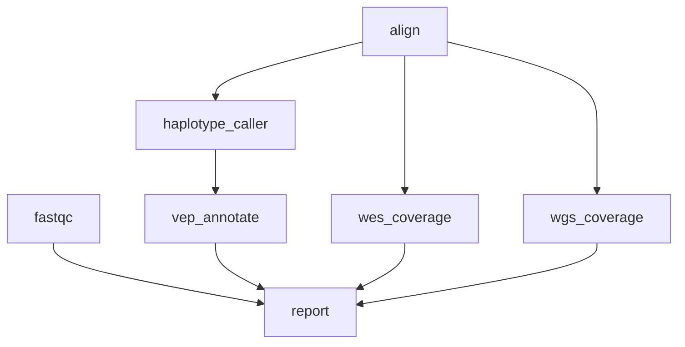

# 11 — Conditional Execution

Rule-level `when` conditions switch pipeline branches on config values: WGS vs WES coverage modes, optional QC gating, and downstream annotation gated on flags and thresholds.

!!! info "What It Demonstrates"

    - `when` supports bare boolean config keys (`config.run_qc`), string comparisons (`config.sequencing_mode == "WGS"`), and compound expressions with `&&` / `||` / `!`
    - Condition-skipped rules count as satisfied for their dependents — safe to `depends_on` them
    - Directory inputs infer edges to producers writing under them; the report rule still uses `depends_on` to keep that ordering explicit
    - Read groups are set at alignment so every downstream tool (GATK included) sees proper SM tags

## Pipeline Overview



`align` and `fastqc` start in parallel. The alignment output feeds three consumers: germline variant calling and two alternative coverage rules — `wgs_coverage` and `wes_coverage` — of which exactly one runs per invocation, chosen by `config.sequencing_mode`. Annotation is gated on `config.run_annotation && config.min_coverage >= 20`, and the final report collects everything, including the QC branch.

## Workflow Definition

```toml
# examples/gallery/11_conditional_workflow.oxoflow
--8<-- "examples/gallery/11_conditional_workflow.oxoflow"
```

## Running the Workflow

### Validate

```bash
$ oxo-flow validate examples/gallery/11_conditional_workflow.oxoflow
✓ examples/gallery/11_conditional_workflow.oxoflow — 7 rules, 8 dependencies

  ⚠ Warning: The following input files do not exist:
    - raw/sample_R1.fq.gz
    - raw/sample_R2.fq.gz
    - raw/sample_R1.fq.gz
    - raw/sample_R2.fq.gz
    - qc/
```

The `✓` line is what matters — validate exits 0 and the workflow is well-formed. The warnings are expected here: the `raw/` FASTQs and the `qc/` directory don't exist until you stage real data (see the note at the bottom of this page).

### Dry-Run

```bash
$ oxo-flow dry-run examples/gallery/11_conditional_workflow.oxoflow
Plan: would run: 6 | skip: 1 | completed: 0 (DAG size: 7)
  ...
  4. wes_coverage  [skip: when condition false]
     ...
  5. wgs_coverage  [run: never completed]
     ...

Summary: 7 rules, total 30 threads declared, max 8 threads/rule
         7 rules with memory requirements

To execute:  oxo-flow run examples/gallery/11_conditional_workflow.oxoflow -j 2
```

The template ships with `sequencing_mode = "WGS"`, so `wes_coverage` is reported as `skip: when condition false` while `wgs_coverage` stays in the plan. Note that `wes_coverage` still appears in the DAG — a `when`-skipped rule remains in the graph but counts as satisfied, which is why the report rule can `depends_on` both coverage variants without ever deadlocking. Flip `sequencing_mode` (and set a `target_bed`) in `[config]` and the dry-run flips with it.

### DAG Structure

```bash
$ oxo-flow graph examples/gallery/11_conditional_workflow.oxoflow
Workflow DAG: 7 rules, 8 dependencies
Depth: 4, Width: 3, Critical path: 4 steps

Critical path: align → haplotype_caller → vep_annotate → report
```

The `graph` command shows the template DAG (before expansion — see the [gallery index](index.md#quick-start) note). The critical path runs through variant calling and annotation; the coverage rules and `fastqc` hang off it as parallel branches.

## Expected Outputs

| Path | Producer |
|------|----------|
| `aligned/sample.sorted.bam` | `align` |
| `qc/sample_R1_fastqc.html`, `qc/sample_R2_fastqc.html` | `fastqc` |
| `qc/sample.mosdepth.summary.txt` | `wes_coverage` or `wgs_coverage` (exactly one) |
| `variants/sample.g.vcf.gz` | `haplotype_caller` |
| `annotated/sample.annotated.vcf.gz` | `vep_annotate` (gated) |
| `reports/sample_report.html` | `report` |

## What's Next?

- How-to guide: [Conditional Rules](../how-to/conditional-rules.md) — writing `when` expressions, supported operators, and common gating patterns.
- Field reference: [`when` — Conditional Rule Execution (WF-01)](../reference/workflow-format.md#when-conditional-rule-execution-wf-01).

!!! note "Input data and environments"

    Input paths under `/data/references/...` and `raw/` are placeholders —
    replace them with your own data. The `validate` warnings about missing
    `raw/` files and the `qc/` directory are expected until real data is
    staged. The referenced `envs/*.yaml` specs ship in
    [`examples/envs/`](https://github.com/Traitome/oxo-flow/tree/main/examples/envs).
