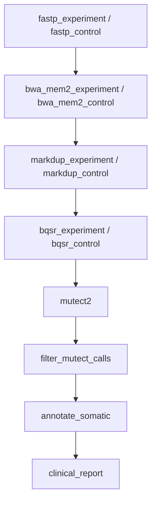

# 15 — Paired Experiment-Control (Multiple Pairs)

The scalable version of [Paired Experiment-Control (Single Pair)](paired-experiment-control.md): the same somatic pipeline driven by `[[pairs]]` with `{experiment}` / `{control}` / `{pair_id}` wildcards, fanning out one branch per pair.

## What It Demonstrates

- `[[pairs]]` entries expand wildcard rules per pair; aggregation rules without pair wildcards stay single-instance
- `--germline-resource` / `--panel-of-normals` are noted in-rule for production hardening
- Read-group SM tags per branch make `Mutect2 -normal {control}` resolve correctly

## Pipeline Overview



Each rule row in the diagram above is a template that fans out per pair: with the two `[[pairs]]` entries (CASE_001, CASE_002), every paired rule produces two instances (`fastp_control_CASE_001`, `fastp_control_CASE_002`, …) and `mutect2` consumes that pair's recalibrated experiment and control BAMs. The pair-scoped chain ends in a per-pair clinical report.

## Workflow Definition

```toml
# examples/gallery/15_paired_experiment_control_pairs.oxoflow
--8<-- "examples/gallery/15_paired_experiment_control_pairs.oxoflow"
```

## Running the Workflow

### Validate

```bash
$ oxo-flow validate examples/gallery/15_paired_experiment_control_pairs.oxoflow
✓ examples/gallery/15_paired_experiment_control_pairs.oxoflow — 12 rules, 17 dependencies

  ⚠ Warning: The following input files do not exist:
    - raw/EXP_01_R1.fq.gz
    - raw/EXP_01_R2.fq.gz
    - raw/CTRL_01_R1.fq.gz
    - raw/CTRL_01_R2.fq.gz
    - raw/EXP_02_R1.fq.gz
    ...
```

The `✓` line is what matters — validate exits 0 and the workflow is well-formed. The warnings are expected here: the `raw/` FASTQs don't exist until you stage real data (see the note at the bottom of this page).

### Dry-Run

```bash
$ oxo-flow dry-run examples/gallery/15_paired_experiment_control_pairs.oxoflow
Plan: would run: 24 | skip: 0 | completed: 0 (DAG size: 24)
Sample readiness: 0/4 complete, 4 waiting
    ⏳ EXP_01 (missing: raw/EXP_01_R1.fq.gz +1 more)
    ⏳ CTRL_01 (missing: raw/CTRL_01_R1.fq.gz +1 more)
    ⏳ EXP_02 (missing: raw/EXP_02_R1.fq.gz +1 more)
    ⏳ CTRL_02 (missing: raw/CTRL_02_R1.fq.gz +1 more)
  ...

17. mutect2_CASE_001  [run: never completed]
     outputs: ["variants/CASE_001.mutect2.vcf.gz"]
     command: # Production runs should also pass --germline-resource and --panel-of-normals
gatk Mutect2 ... -I recal/EXP_01.recal.bam -I recal/CTRL_01.recal.bam -normal CTRL_01 -O variants/CASE_001.mutect2.vcf.gz

Summary: 24 rules, total 152 threads declared, max 16 threads/rule
         24 rules with memory requirements

To execute:  oxo-flow run examples/gallery/15_paired_experiment_control_pairs.oxoflow -j 2
```

The 12 template rules expand to 24 tasks — each pair-scoped rule runs once per `[[pairs]]` entry, with instance names keyed by `pair_id` (`fastp_control_CASE_001`, `mutect2_CASE_001`, `clinical_report_CASE_001`, …). Compare the `mutect2` command with workflow 14: `-I recal/EXP_01.recal.bam` and `-normal CTRL_01` are literal there, while here `{experiment}` and `{control}` resolve them per pair. The in-rule comment about `--germline-resource` and `--panel-of-normals` is carried verbatim into the command — production runs should uncomment those flags with real resource paths.

### DAG Structure

```bash
$ oxo-flow graph examples/gallery/15_paired_experiment_control_pairs.oxoflow
Workflow DAG: 12 rules, 17 dependencies
Depth: 8, Width: 2, Critical path: 8 steps

Critical path: fastp_control → bwa_mem2_control → markdup_control → bqsr_control → mutect2 → filter_mutect_calls → annotate_somatic → clinical_report
```

`graph` shows the template DAG (before expansion — see the [gallery index](index.md#quick-start) note). Unlike the single-pair workflow 14, the paired rules show **cross-branch dependencies at every level** — `bwa_mem2_control [depends: fastp_control, fastp_experiment]` and `markdup_control [depends: bwa_mem2_control, bwa_mem2_experiment]` — because each branch's files must be uniquely named per pair, so every stage waits on both the experiment and control upstream instances before writing its own pair-scoped outputs.

## Expected Outputs

| Path | Producer |
|------|----------|
| `trimmed/{experiment}_R1.fq.gz`, `trimmed/{control}_R1.fq.gz`, … | `fastp_experiment` / `fastp_control` |
| `aligned/{experiment}.sorted.bam`, `aligned/{control}.sorted.bam` | `bwa_mem2_experiment` / `bwa_mem2_control` |
| `dedup/{experiment}.dedup.bam`, `dedup/{control}.dedup.bam` | `markdup_experiment` / `markdup_control` |
| `recal/{experiment}.recal.bam`, `recal/{control}.recal.bam` | `bqsr_experiment` / `bqsr_control` |
| `variants/{pair_id}.mutect2.vcf.gz` | `mutect2` |
| `variants/{pair_id}.mutect2.filtered.vcf.gz` | `filter_mutect_calls` |
| `annotated/{pair_id}.annotated.vcf.gz` | `annotate_somatic` |
| `reports/{pair_id}_clinical_report.html` | `clinical_report` |

With the shipped `[[pairs]]` table, `{pair_id}` resolves to `CASE_001` (lung adenocarcinoma) and `CASE_002` (colorectal).

## What's Next?

- The single-pair version: [Paired Experiment-Control (Single Pair)](paired-experiment-control.md) — the hardcoded, readable variant of this pipeline.
- Field reference: [`pairs` — Experiment-Control Pairing (WC-01)](../reference/workflow-format.md#pairs-experiment-control-pairing-wc-01).

!!! note "Input data and environments"

    Input paths under `/data/references/...` and `raw/` are placeholders —
    replace them with your own data. The `validate` warnings about missing
    `raw/` files are expected until real data is staged. The referenced
    `envs/*.yaml` specs ship in
    [`examples/envs/`](https://github.com/Traitome/oxo-flow/tree/main/examples/envs).
