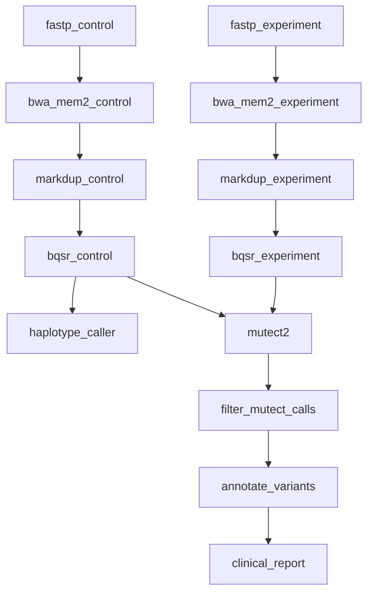

# 14 — Paired Experiment-Control (Single Pair)

Somatic variant calling for one tumor/control pair with hardcoded sample names — the readable version of the [[pairs]]-driven pattern in [Paired Experiment-Control (Multiple Pairs)](paired-experiment-control-pairs.md).

## What It Demonstrates

- Both tumor and control flow through identical QC → align → dedup → BQSR stages in parallel branches
- Mutect2 `-normal CTRL_01` resolves via the read-group SM tag set at alignment
- BQSR table and application run in one rule (intermediate table kept inside the shell)

## Pipeline Overview



Two mirror-image branches process tumor (`EXP_01`) and control (`CTRL_01`) independently through QC, alignment, deduplication, and BQSR. They converge in `mutect2`, which takes both recalibrated BAMs as input; the somatic chain then runs straight through filtering, annotation, and the clinical report.

## Workflow Definition

```toml
# examples/gallery/14_paired_experiment_control.oxoflow
--8<-- "examples/gallery/14_paired_experiment_control.oxoflow"
```

## Running the Workflow

### Validate

```bash
$ oxo-flow validate examples/gallery/14_paired_experiment_control.oxoflow
✓ examples/gallery/14_paired_experiment_control.oxoflow — 13 rules, 12 dependencies

  ⚠ Warning: The following input files do not exist:
    - raw/EXP_01_R1.fq.gz
    - raw/EXP_01_R2.fq.gz
    - raw/CTRL_01_R1.fq.gz
    - raw/CTRL_01_R2.fq.gz
```

The `✓` line is what matters — validate exits 0 and the workflow is well-formed. The warnings are expected here: the `raw/` FASTQs don't exist until you stage real data (see the note at the bottom of this page).

### Dry-Run

```bash
$ oxo-flow dry-run examples/gallery/14_paired_experiment_control.oxoflow
Plan: would run: 13 | skip: 0 | completed: 0 (DAG size: 13)
  ...

10. mutect2  [run: never completed]
     outputs: ["variants/EXP_01.mutect2.vcf.gz"]
     command: gatk Mutect2 ... -I recal/EXP_01.recal.bam -I recal/CTRL_01.recal.bam -normal CTRL_01 -R /data/references/GRCh38/genome.fa -O variants/EXP_01.mutect2.vcf.gz

Summary: 13 rules, total 86 threads declared, max 16 threads/rule
         13 rules with memory requirements

To execute:  oxo-flow run examples/gallery/14_paired_experiment_control.oxoflow -j 2
```

Because both sample names are hardcoded, the plan equals the template — 13 rules, no expansion, and no sample-readiness block. The `mutect2` command is the teaching moment: both branches' recalibrated BAMs appear as `-I` inputs, and `-normal CTRL_01` names the control by the SM tag that `bwa_mem2_control` wrote into the BAM header via its read-group string. `haplotype_caller` runs only on the control branch (`variants/CTRL_01.g.vcf.gz`) — a common strategy to profile the normal's germline background.

### DAG Structure

```bash
$ oxo-flow graph examples/gallery/14_paired_experiment_control.oxoflow
Workflow DAG: 13 rules, 12 dependencies
Depth: 8, Width: 2, Critical path: 8 steps

Critical path: fastp_control → bwa_mem2_control → markdup_control → bqsr_control → mutect2 → filter_mutect_calls → annotate_variants → clinical_report
```

`graph` shows the template DAG (before expansion — see the [gallery index](index.md#quick-start) note). Through the first four levels every dependency stays within its own branch (`bwa_mem2_control [depends: fastp_control]`) — the two branches only meet at `mutect2`.

## Expected Outputs

| Path | Producer |
|------|----------|
| `trimmed/EXP_01_R1.fq.gz`, `trimmed/EXP_01_R2.fq.gz` (+ CTRL_01) | `fastp_experiment` / `fastp_control` |
| `aligned/EXP_01.sorted.bam`, `aligned/CTRL_01.sorted.bam` | `bwa_mem2_experiment` / `bwa_mem2_control` |
| `dedup/{EXP_01,CTRL_01}.dedup.bam` + metrics | `markdup_experiment` / `markdup_control` |
| `recal/{EXP_01,CTRL_01}.recal.bam` | `bqsr_experiment` / `bqsr_control` |
| `variants/CTRL_01.g.vcf.gz` | `haplotype_caller` (control only) |
| `variants/EXP_01.mutect2.vcf.gz` | `mutect2` |
| `variants/EXP_01.mutect2.filtered.vcf.gz` | `filter_mutect_calls` |
| `annotated/EXP_01.annotated.vcf.gz` | `annotate_variants` |
| `reports/EXP_01_report.html` | `clinical_report` |

## What's Next?

- Scale it up: [Paired Experiment-Control (Multiple Pairs)](paired-experiment-control-pairs.md) — the same chain driven by `[[pairs]]`.
- How-to guide: [Experiment-Control Pairing](../how-to/experiment-control-pairing.md) — pairing syntax and naming conventions.

!!! note "Input data and environments"

    Input paths under `/data/references/...` and `raw/` are placeholders —
    replace them with your own data. The `validate` warnings about missing
    `raw/` files are expected until real data is staged. The referenced
    `envs/*.yaml` specs ship in
    [`examples/envs/`](https://github.com/Traitome/oxo-flow/tree/main/examples/envs).
