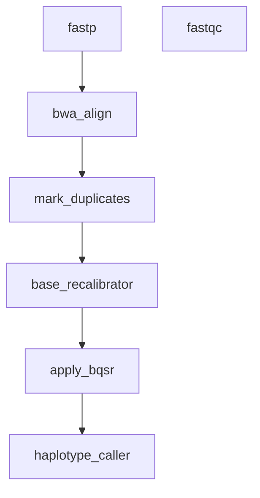

# 13 — Germline Variant Calling (Simple Chain)

The per-sample GATK germline chain: FastQC + fastp QC, BWA-MEM2 alignment with read groups, MarkDuplicates, BQSR, and HaplotypeCaller GVCF — the simpler sibling of [WGS Germline Variant Calling](wgs-germline.md), which adds joint calling, VQSR, and annotation.

## What It Demonstrates

- Read-group string built with `printf '@RG\tID:%s\tSM:%s\tPL:ILLUMINA'` renders real TAB separators
- Each stage declares its own environment (conda for QC tools, singularity for GATK)
- Mix of environment backends per rule is first-class

## Pipeline Overview



Three samples (`NA12878`, `NA12891`, `NA12892`) expand every rule into three parallel instances. The backbone is a strict six-stage chain ending in HaplotypeCaller; `fastqc` is a standalone QC rule with no downstream consumers — it runs independently of the chain.

## Workflow Definition

```toml
# examples/gallery/13_simple_variant_calling.oxoflow
--8<-- "examples/gallery/13_simple_variant_calling.oxoflow"
```

## Running the Workflow

### Validate

```bash
$ oxo-flow validate examples/gallery/13_simple_variant_calling.oxoflow
✓ examples/gallery/13_simple_variant_calling.oxoflow — 7 rules, 6 dependencies

  ⚠ Warning: The following input files do not exist:
    - raw/NA12878_R1.fastq.gz
    - raw/NA12878_R2.fastq.gz
    ...
```

The `✓` line is what matters — validate exits 0 and the workflow is well-formed. The warnings are expected here: the `raw/` FASTQs don't exist until you stage real data (see the note at the bottom of this page).

### Dry-Run

```bash
$ oxo-flow dry-run examples/gallery/13_simple_variant_calling.oxoflow
Plan: would run: 21 | skip: 0 | completed: 0 (DAG size: 21)
Sample readiness: 0/3 complete, 3 waiting
    ⏳ NA12878 (missing: raw/NA12878_R1.fastq.gz +1 more)
    ⏳ NA12891 (missing: raw/NA12891_R1.fastq.gz +1 more)
    ⏳ NA12892 (missing: raw/NA12892_R1.fastq.gz +1 more)
  ...

1. fastp_samples_NA12878  [run: never completed]
     threads=8
     env=conda
     ...
7. bwa_align_samples_NA12878  [run: never completed]
     threads=16
     env=conda
     ...
10. mark_duplicates_samples_NA12878  [run: never completed]
     env=singularity

Summary: 21 rules, total 126 threads declared, max 16 threads/rule
         21 rules with memory requirements
         1 sample group, 0 pairs

To execute:  oxo-flow run examples/gallery/13_simple_variant_calling.oxoflow -j 2
```

The 7 template rules expand to 21 tasks (7 rules × 3 samples); instance names are suffixed `_samples_<sample>`. The env mix is visible directly in the dry-run output: the QC and alignment stages report `env=conda`, while from `mark_duplicates` onward every GATK stage reports `env=singularity` (`docker://broadinstitute/gatk:4.5.0.0`). BQSR is split into two rules — `base_recalibrator` emits the recalibration table, and `apply_bqsr` consumes it together with the deduplicated BAM.

### DAG Structure

```bash
$ oxo-flow graph examples/gallery/13_simple_variant_calling.oxoflow
Workflow DAG: 7 rules, 6 dependencies
Depth: 6, Width: 2, Critical path: 6 steps

Critical path: fastp → bwa_align → mark_duplicates → base_recalibrator → apply_bqsr → haplotype_caller
```

`graph` shows the template DAG (before expansion — see the [gallery index](index.md#quick-start) note). `apply_bqsr` depends on both `base_recalibrator` (the recal table) and `mark_duplicates` (the dedup BAM).

## Expected Outputs

| Path | Producer |
|------|----------|
| `qc/{sample}_R1_fastqc.html`, `qc/{sample}_R2_fastqc.html` | `fastqc` |
| `trimmed/{sample}_R1.fastq.gz`, `trimmed/{sample}_R2.fastq.gz`, `qc/{sample}_fastp.json` | `fastp` |
| `aligned/{sample}.sorted.bam` | `bwa_align` |
| `dedup/{sample}.dedup.bam`, `dedup/{sample}.metrics.txt` | `mark_duplicates` |
| `recal/{sample}.recal_data.table` | `base_recalibrator` |
| `recal/{sample}.recal.bam` | `apply_bqsr` |
| `variants/{sample}.g.vcf.gz` | `haplotype_caller` |

## What's Next?

- The full pipeline: [WGS Germline Variant Calling](wgs-germline.md) — adds cohort joint genotyping, VQSR, and VEP annotation on top of this chain.
- Field reference: [Rules](../reference/workflow-format.md#rules-rule-definitions) — `environment` backends and per-rule resources.

!!! note "Input data and environments"

    Input paths under `/data/references/...` and `raw/` are placeholders —
    replace them with your own data. The `validate` warnings about missing
    `raw/` files are expected until real data is staged. The referenced
    `envs/*.yaml` specs ship in
    [`examples/envs/`](https://github.com/Traitome/oxo-flow/tree/main/examples/envs).
