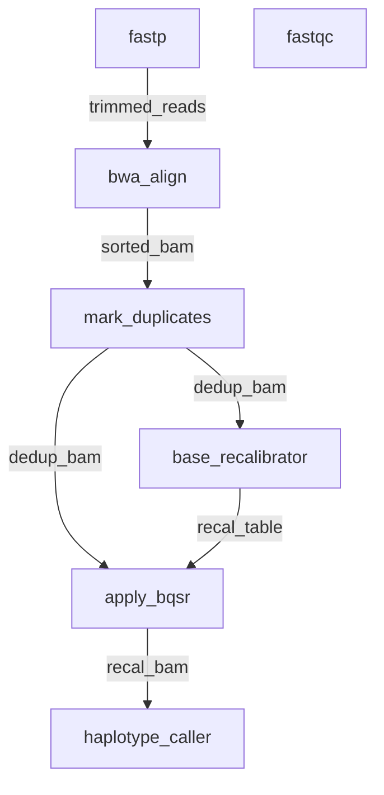

# 17 — Typed Germline Variant Calling

The [gallery 13](simple-variant-calling.md) per-sample GATK chain with a full
**biological type contract** layer added: every edge that crosses between two
rules carries a declared `[types.*]` contract — format, sort order, companion
index, reference build, read groups, and compression — so the static BioType
checker verifies the whole dataflow **before any command runs**.

## What It Demonstrates

- Named, reusable `[types.<name>]` tables bound to rule channels by name
- Per-rule `[rules.types]` `inputs` / `outputs` channel maps that pair channels across edges
- A contract on **both sides** of every crossing edge: producer format/sort/index/build/read-group/compression vs consumer requirement
- An untyped rule (`fastqc`) coexisting with typed rules — the checker leaves it silent because nothing consumes its output
- A real preflight failure: the same pipeline with one broken contract is rejected at `validate` time with a `TYPE-001` diagnostic instead of failing at run time

## Pipeline Overview



The edge labels are the **biological types** that cross each edge — the
contract the checker verifies. Three samples (`NA12878`, `NA12891`, `NA12892`)
expand every rule into three parallel instances.

## Workflow Definition

```toml
# examples/gallery/17_typed_variant_calling.oxoflow
--8<-- "examples/gallery/17_typed_variant_calling.oxoflow"
```

The named types are declared once at the top of the file and referenced by name
from each rule's `[rules.types]` table:

| Type | Biological contract |
|------|---------------------|
| `trimmed_reads` | `fastq`, gzip |
| `sorted_bam` | `bam`, coordinate, `bai` index, `GRCh38`, read groups (`ID`/`SM`/`PL`) |
| `dedup_bam` | `bam`, coordinate, `bai` index, `GRCh38`, read groups |
| `recal_table` | `tsv` (no alignment contract — not a read file) |
| `recal_bam` | `bam`, coordinate, `GRCh38`, read groups, **no** companion index |
| `germline_gvcf` | `vcf`, bgzip, `GRCh38`, germline variant attribute |

## Running the Workflow

### Validate

```bash
$ oxo-flow validate examples/gallery/17_typed_variant_calling.oxoflow
✓ examples/gallery/17_typed_variant_calling.oxoflow — 7 rules, 6 dependencies

  ⚠ Warning: The following input files do not exist:
    - raw/NA12878_R1.fastq.gz
    - raw/NA12878_R2.fastq.gz
    ...
```

Validate exits 0 and reports **no errors and no type diagnostics**: every
crossing edge forms exactly one matched producer/consumer channel pair, so the
contracts are satisfied. The `raw/` FASTQ warnings are the same expected
missing-input notices as gallery 13 — they appear only until real data is staged.

### The Contract Is Load-Bearing

Change a single consumer requirement so it no longer matches what its producer
emits — here, ask `mark_duplicates` for a `SAM` instead of the `BAM` that
`bwa_align` produces:

```toml
[rules.types]
inputs = { aligned = "SAM" }
```

Re-running `validate` now fails closed with one error:

```text
[TYPE-001] rule 'mark_duplicates': upstream rule 'bwa_align' (aligned -> aligned):
           biological format mismatch: producer emits bam, but consumer requires sam
           → connect an adapter rule to convert bam into sam
```

This is the point of the contract layer: the biological incompatibility is
caught in preflight, not after an expensive alignment run.

### Dry-Run

```bash
$ oxo-flow dry-run examples/gallery/17_typed_variant_calling.oxoflow
Plan: would run: 21 | skip: 0 | completed: 0 (DAG size: 21)
Sample readiness: 0/3 complete, 3 waiting
```

The plan is identical to gallery 13 — types are a **static validation layer**;
they change no execution semantics, only what is accepted at preflight. The 7
template rules expand to 21 tasks (7 rules × 3 samples).

### DAG Structure

```bash
$ oxo-flow graph examples/gallery/17_typed_variant_calling.oxoflow
Workflow DAG: 7 rules, 6 dependencies
Depth: 6, Width: 2, Critical path: 6 steps

Critical path: fastp → bwa_align → mark_duplicates → base_recalibrator → apply_bqsr → haplotype_caller
```

## Expected Outputs

| Path | Producer | Declared type |
|------|----------|---------------|
| `qc/{sample}_R1_fastqc.html`, `qc/{sample}_R2_fastqc.html` | `fastqc` | (untyped) |
| `trimmed/{sample}_R1.fastq.gz`, `trimmed/{sample}_R2.fastq.gz` | `fastp` | `trimmed_reads` |
| `aligned/{sample}.sorted.bam` | `bwa_align` | `sorted_bam` |
| `dedup/{sample}.dedup.bam` | `mark_duplicates` | `dedup_bam` |
| `recal/{sample}.recal_data.table` | `base_recalibrator` | `recal_table` |
| `recal/{sample}.recal.bam` | `apply_bqsr` | `recal_bam` |
| `variants/{sample}.g.vcf.gz` | `haplotype_caller` | `germline_gvcf` |

## What's Next?

- The untyped base pipeline: [Germline Variant Calling (Simple Chain)](simple-variant-calling.md)
- Full pipeline with cohort joint genotyping: [WGS Germline Variant Calling](wgs-germline.md)
- Field reference: [Biological types](../reference/workflow-format.md) — the `[types.*]` tables, `[rules.types]` channel maps, and the `TYPE-0xx` diagnostic catalogue.

!!! note "Input data and environments"

    Input paths under `/data/reference/...` and `raw/` are placeholders —
    replace them with your own data. The `validate` warnings about missing
    `raw/` files are expected until real data is staged. The referenced
    `envs/*.yaml` specs ship in
    [`examples/envs/`](https://github.com/Traitome/oxo-flow/tree/main/examples/envs).
