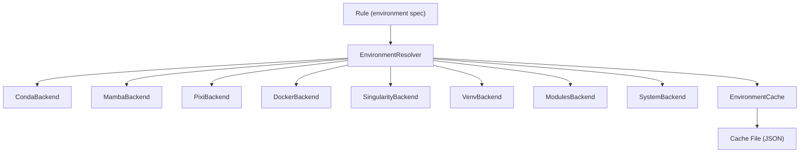

# Environment System

The environment system manages software environment resolution, activation, and deactivation for each rule in a workflow.

---

## Overview

Each rule can declare an environment specification. Before a rule's shell command runs, oxo-flow:

1. Resolves the environment spec to a concrete backend
2. Ensures the environment is ready (created, pulled, etc.)
3. Activates the environment
4. Runs the shell command
5. Deactivates the environment

---

## Architecture



### EnvironmentResolver

The central coordinator that:

- Detects available backends on the system
- Validates environment specifications
- Dispatches to the appropriate backend
- Tracks environment setup state via EnvironmentCache

```rust
let resolver = EnvironmentResolver::new();
let available = resolver.available_backends(); // e.g. ["system", "mamba", "conda", "pixi", "docker", "singularity", "venv", "modules"] — installed backends only
resolver.validate_spec(&rule.environment)?;
```

### EnvironmentCache

Tracks which environments have been successfully set up:

- **In-memory cache**: Tracks ready environments during execution
- **Persistent cache**: Optionally saves state to a JSON file for reuse across runs

```rust
// Create resolver with persistent cache
let resolver = EnvironmentResolver::with_cache_dir(Path::new(".oxo-flow/cache"));
```

When using `--cache-dir`, oxo-flow saves environment setup state after each run. Subsequent runs skip setup for already-ready environments, reducing startup time.

---

## Environment Setup Process

Before executing a rule with an environment specification:

1. **Check cache**: If the environment is already marked as ready, skip setup
2. **Run setup command**: Execute the backend's setup command (e.g., `conda env create -f env.yaml`)
3. **Mark ready**: Cache the environment as successfully set up

### Setup Commands by Backend

| Backend | Setup Command |
|---|---|
| Conda | `conda env create -n <env> -f <yaml_file>` (falls back to `conda env update -n <env> -f <yaml_file>` if the env already exists) |
| Mamba | `<mamba\|micromamba\|conda> env create -n <env> -f <yaml_file>` (falls back to `env update`; auto-detects mamba, micromamba, or conda) |
| Pixi | `pixi install --manifest-path <pixi.toml>` (manifest must exist — validated upfront) |
| Docker | `docker image inspect <image> \|\| docker pull <image>` — pull only when absent; bare names that 404 on Docker Hub get one quay.io/biocontainers retry re-tagged to the original name |
| Singularity | Pull when needed: a URI (`docker://…`) is pulled to a derived `.sif` name; a local `.sif` path is used as-is |
| Venv | `python3 -m venv <path> && . <path>/bin/activate && pip install -r <requirements>` — the `pip install` leg is skipped, with a warning naming the expected path, when the requirements file does not exist |
| Modules | None (no setup — modules are loaded at execution time) |
| System | None (no setup needed — commands run directly in the current shell) |

### Setup runs with the operator's environment (accepted risk, issue #1174)

The setup commands above — and their teardown, retry, and verification
forms — run under the **full ambient environment** of the `oxo-flow`
process. This is deliberately different from rule execution: rule shells,
`pre_exec` hooks, and rule-/workflow-level hooks run under a cleared
environment plus a fixed allowlist (issue #1108, RB-15), so they cannot
read ambient secrets from their own process environment. Environment setup
keeps proxy, mirror, and certificate configuration (`HTTP_PROXY`,
`HTTPS_PROXY`, `NO_PROXY`, `PIP_INDEX_URL`, `PIP_TRUSTED_HOST`,
`SSL_CERT_FILE`, `CONDA_*`, corporate mirrors), which conda, pip, and pixi
need in order to provision at all.

This is an explicit accepted risk, not an isolation guarantee. Setup inputs
are workflow-authored executable content: a pinned sdist's build backend
(`setup.py`, `pyproject.toml`) runs during `pip install`, and conda
installs run package post-link scripts. That code runs as the operator with
ordinary filesystem access, so it can read `~/.aws/credentials`,
`~/.docker/config.json`, or `$HOME/.oxo-flow/ai_config.json` whether or not
its environment was cleared — clearing the environment would be cosmetic.
The real boundary is the workflow-trust decision: **do not run workflows
you do not trust** on a machine whose operator credentials you would not
hand to the workflow's author. The same caveat is restated in
[the workflow format reference](workflow-format.md#environment-specification)
and [the run reference](../commands/run.md#rule-execution-environment-issue-1108).

### Skipping Setup

Use `--skip-env-setup` when environments are pre-built:

```bash
# Environments already exist on the system
oxo-flow run pipeline.oxoflow --skip-env-setup
```

With the flag set, the engine does not create anything — a rule whose env
is missing fails inside conda. For file-backed conda specs it therefore
checks `conda env list` up front and names the expected `<name>-<hash8>`
env before running: if an env under the plain `<name>` exists, it was
likely built from the same spec before the content-hash suffix — symlink
or rename it, build the suffixed env, or drop `--skip-env-setup`.

---

## Backend Implementations

### Conda

- **Detection**: Checks for `conda` on `$PATH`
- **Resolution**: Parses YAML environment file
- **Naming**: A file-backed spec resolves to the env name `<name>-<hash8>`, where `<name>` is the YAML's `name:` field (falling back to the file stem) and `<hash8>` is the first 4 bytes of the spec's SHA-256 as 8 hex chars — two workflows shipping different YAMLs under the same name then build into distinct envs instead of silently sharing one. Same content → same name, so identical specs deduplicate. Pre-create envs with exactly that name (`conda env create -n <name>-<hash8> -f envs/spec.yaml`); the engine prints the expected name when it detects the env is missing under `--skip-env-setup`
- **Activation**: Runs `conda run --no-capture-output -n <env_name> bash -c 'export PATH="$CONDA_PREFIX/bin:$PATH"; <command>'` — `--no-capture-output` (conda ≥ 4.13) keeps stdout/stderr live, and the `PATH` prefix makes the rule see the env's own tools first
- **Caching**: Environments are created once and reused across rules that share the same YAML file
- **Empty dependency sets**: a file-backed YAML whose `dependencies:` list is empty (or absent) is rejected at validation — `env check` and the run's backend preflight name the offending file before any solve starts. `conda env create` otherwise exits 0 after a full solve and leaves a prefix with no `bin/`, which then fails verification and reads like an interrupted creation. Add at least one package or remove the environment declaration. Mamba specs use the same format and the same check

### Mamba

- **Detection**: Checks for `mamba`, then `micromamba`, then falls back to `conda` on `$PATH`
- **Resolution**: Parses YAML environment file (same format as conda)
- **Activation**: Runs `<mamba|micromamba|conda> run -n <env_name> bash -c 'export PATH="$CONDA_PREFIX/bin:$PATH"; <command>'` — the `PATH` prefix makes the rule see the env's own tools first on hybrid boxes (same rationale as conda). When the detected binary is `conda` (fallback), `--no-capture-output` is added like the conda backend; native mamba/micromamba reject that flag, so it is only added for conda
- **Caching**: Environments are created once and reused across rules that share the same YAML file
- **Usage**: Set `environment.mamba = "envs/qc.yaml"` in the rule. Uses the same YAML format as conda but with the mamba/micromamba binary for faster solving.

### Pixi

- **Detection**: Checks for `pixi` on `$PATH`
- **Resolution**: Parses the `pixi.toml` manifest the rule names
- **Activation**: Runs `pixi run --manifest-path <pixi.toml> bash -c '<command>'` — the **whole** rule command travels inside the env. `pixi run` is a child-process environment (like docker), not a PATH-mutating one (like modules/venv): with a bare prefix wrap, shell operators (`&&`, `|`) and the executor's prepended `mkdir -p` line escape the env and run on the host PATH (live-caught on a SLURM cluster). The spec is a **manifest path**, not an environment name (`-e` would only search the current directory for a discoverable manifest)
- **Lockfile**: Pixi's native lockfile ensures reproducible resolution, and is part of the environment's identity: the pixi cache is keyed by the manifest spec **plus content hashes of the manifest and its sibling `pixi.lock`** (`pixi:<path>:<hash8>:<hash8>`), so an in-place edit of either — e.g. committing a reproducibility pin to the lockfile — invalidates the cache and the next run rebuilds the environment. Unreadable or missing files degrade to empty tags. Rule fingerprints carry the same digests, so completed rules referencing the spec are invalidated too (see [run — config changes and precise invalidation](../commands/run.md#config-changes-and-precise-invalidation))
- **Site quirks (live-verified)**: hand-written manifests must declare `platforms` (e.g. `platforms = ["linux-64"]`) — modern pixi refuses to solve a workspace without them; and `pixi` must be on `$PATH` inside batch jobs, which start with a clean environment

### Docker

- **Detection**: Checks for `docker` on `$PATH` (the daemon itself is only
  contacted when a rule runs)
- **Resolution**: Parses image reference (registry/image:tag)
- **Execution**: Wraps the command in `docker run --rm --user $(id -u):$(id -g) -v <workdir>:<workdir> -w <workdir> <image> sh -c '<bash shim>' sh '<command>'`; absolute host paths referenced by the rule but living outside the workdir are added as extra **read-only** binds (`-v /data/ref:/data/ref:ro`)
- **Pull policy**: Images are pulled on first use if not locally available

### Singularity / Apptainer

- **Detection**: Prefers `apptainer` over `singularity`, whichever is found first on `$PATH`
- **Resolution**: Parses image reference (can be `docker://`, `.sif` file, or library URI)
- **Execution**: Wraps the command in `<apptainer|singularity> exec --bind <workdir>:<workdir> <image> sh -c '<bash shim>' sh '<command>'`
- **Binding**: The working directory is bound into the container with an **absolute** path (`--bind` rejects relative sources), plus read-only binds for host paths the rule references

!!! note "The container `<bash shim>`"
    Both container backends hand the rule's command to the image's shell as
    `sh -c 'if command -v bash >/dev/null 2>&1; then exec bash -c "$1"; else
    exec sh -c "$1"; fi' sh '<command>'`. The image's entrypoint shell runs
    first, and it is often a minimal `sh` that cannot execute multi-line or
    `pipefail`-using scripts — the shim re-execs bash whenever the image
    ships it, and falls back to `sh` when it does not.

### Python venv

- **Detection**: Checks for `python3` on `$PATH` (with `ensurepip`/`venv` importable)
- **Resolution**: `environment.venv` names the **venv directory** to create/reuse (e.g. `.venv`); `environment.venv_requirements` names the requirements file (default: `requirements.txt`, resolved against the workflow file's directory like every other file-backed environment spec). Declaring a requirements file path in `venv` itself fails — the backend creates a directory at that path
- **Activation**: Creates the venv (if needed) and activates it before the command. If the requirements file does not exist, setup still creates/reuses the venv but **skips the `pip install` leg** and logs a warning naming the expected path — declaring `venv` on an existing environment never fails inside pip with "Could not open requirements file". An explicit `venv_requirements` pointing at a missing file behaves identically
- **Caching**: Venvs are stored in a cache directory keyed by the declared
  venv spec **plus a content hash of the requirements file**
  (`venv:<path>:<hash8>`), so editing `requirements.txt` in place
  invalidates the cache and the next run rebuilds the environment.
  A missing or unreadable requirements file (including the default
  `requirements.txt` when it does not exist) degrades to the plain
  `venv:<path>` key; the file appearing later changes the key, so the next
  run performs the skipped install.

### HPC Modules

- **Detection**: Checks for `modulecmd` or `module` on `$PATH`
- **Resolution**: Parses the module list (comma-separated) from `environment.modules`
- **Activation**: Initializes the module system (sources `/etc/profile.d/modules.sh` or common Lmod/Modules init scripts), then runs `module load <modules>` before the command. Fails with a clear error if the `module` command is unavailable.
- **Usage**: Set `environment.modules = ["gcc/11.2", "cuda/11.7"]` in the rule. Modules are used when `environment.modules` is set and no other backend is declared (priority: mamba, conda, pixi, docker, singularity, venv, modules).
- **Site quirks (live-verified)**: the wrap mutates `$PATH` inside the rule's
  shell, so a same-named binary from a user-level tool manager (e.g.
  `~/.pixi/bin`, `~/.local/bin`, a conda base) **shadows** the
  module-provided one — probe with `command -v <tool>` when diagnosing. The
  init fallback chain covers Environment Modules under both
  `/usr/share/modules` and `/usr/share/Modules`.

### System

- **Detection**: Always available
- **Resolution**: No environment spec required
- **Activation**: No-op — the command runs directly in the current shell environment
- **Usage**: This is the default backend for rules without an `environment` field

---

## Resolver Order

A rule resolves at most **one** backend, checked in this order:

`mamba` → `conda` → `pixi` → `docker` → `singularity` → `venv` → `modules`.

Declaring `modules` alongside any other backend is a hard error rather than a
silent drop — a container has no module system, so the `module load`s could
only ever be lost.

---

## Environment Specification

The `EnvironmentSpec` struct supports one backend per rule:

```rust
pub struct EnvironmentSpec {
    pub conda: Option<String>,
    pub mamba: Option<String>,
    pub pixi: Option<String>,
    pub docker: Option<String>,
    pub singularity: Option<String>,
    pub venv: Option<String>,
    pub modules: Vec<String>,
    pub conda_prefix: Option<String>,
    pub mamba_prefix: Option<String>,
    pub venv_requirements: Option<String>,
    /// GPU passthrough for docker — `--gpus <value>` (e.g. `"all"`);
    /// rejected at validate time unless a docker image is set.
    pub gpus: Option<String>,
}
```

In TOML:

```toml
# Only one backend per rule — uncomment the one you need:
environment = { conda = "envs/tools.yaml" }
# environment = { docker = "biocontainers/bwa:0.7.17" }
# environment = { venv = ".venv/", venv_requirements = "envs/dev-requirements.txt" }
# environment = { modules = ["gcc/11.2", "cuda/11.7"] }
```

If multiple backends are specified, the first one found is used in this priority order: mamba, conda, pixi, docker, singularity, venv, modules. The `system` backend is used when a rule declares no environment spec.

---

## Default Environments

Set a default in `[defaults]`:

```toml
[defaults]
environment = { conda = "envs/base.yaml" }
```

Rules without an explicit `environment` field inherit the default. Rules with an explicit `environment` override the default completely.

---

## Validation

```bash
# Check that all backends are available
oxo-flow env list

# Validate all environments in a workflow
oxo-flow env check pipeline.oxoflow
```

The `env check` command calls the resolver's `validate_spec` for each rule's
environment (relative file specs — `conda`/`mamba`/`pixi`/
`venv_requirements` — resolve against the workflow directory first),
which verifies **backend availability on the current system**
(e.g. the conda/pixi/docker/singularity binary exists and is runnable;
a pixi spec must point at a `pixi.toml` manifest). It does not
re-check spec files or image reference syntax — `validate` and `lint` cover
declaration-level checks.

## Shared environment store (opt-in)

By default every workflow is **self-contained**: pixi and venv environments
materialize inside the workflow tree (`.pixi` next to the manifest, the venv
dir) like any other artifact. Setting `OXO_FLOW_ENV_STORE` to a non-empty
path **activates** the shared store (location IS activation): the env then
materializes once per content key under the store root and the in-tree
location becomes a symlink, so `pixi run --manifest-path` and
`source .venv/bin/activate` keep working unchanged. The variable is
per-process — on a multi-user server each user who opts in gets their own
store unless an operator deliberately points everyone at a shared path.
Maintenance is `oxo-flow env gc` (checkpoint-reference + age gated,
`--dry-run` first); a broken link is detected on the next run, the dangling
in-tree symlink is detached, and the env is rebuilt automatically. A
content-key change (edited `requirements.txt` or `pixi.toml`) gets a new
store entry: the next run detaches the stale in-tree
symlink, builds the new environment in-tree, and re-homes it under the new
key. The previous store dir is left untouched for other workflows and for
`env gc`. The store deliberately covers **pixi and venv
only**: conda/mamba name-based environments already live in a shared central
prefix, conda prefix environments are not relocatable (absolute paths baked
into the env), containers pull images into their own registries, and HPC
modules are provided by the cluster — none of them benefit from a
content-keyed store. Details: [`env` command](../commands/env.md#env-gc).

---

## Shared conda-family lifecycle (create → use → decommission)

conda and mamba are **one lifecycle implementation**, not two copies: every
command the RULE lifecycle runs for them is generated by the single
`conda_family_*` builder family in `crates/oxo-flow-core/src/environment.rs`
(`conda_family_target`, `conda_family_setup`, `conda_family_verify`,
`conda_family_wrap`, `conda_family_teardown`, `conda_family_cache_key`).
Two deliberate exceptions exist: the standalone `oxo-flow env create` bootstrap
(`commands/infra.rs`) creates a user-named environment outside the rule
lifecycle (its name is the documented user contract), and the generated
container Dockerfiles emit their own `conda env create` line
(`container.rs`) while sharing the name derivation.
`CondaBackend` and `MambaBackend` contribute only the binary token (plus the
documented conda-only `--no-capture-output` on the wrap);
`EnvironmentResolver` is the single dispatch point the executor calls for
every backend.

The lifecycle the engine drives for every backend is:

1. **create** — `EnvironmentResolver::setup_command`: conda/mamba share the
   `create || update` builder, pixi is `pixi install --manifest-path`; the
   executor runs the command through `sh -c` in the workdir.
2. **verify** — conda/mamba only: the shared
   `run … test -d "$CONDA_PREFIX/bin"` probe. A failure tears the
   environment down through the shared teardown builder and retries the same
   create command once.
3. **use** — `EnvironmentResolver::wrap_command` wraps the rule: the shared
   `conda run … bash -c 'export PATH="$CONDA_PREFIX/bin:$PATH"; …'` or
   `pixi run --manifest-path … bash -c …`.
4. **decommission** — conda/mamba remove the environment with the shared
   `env remove -n <name> -y` teardown; pixi (and venv) are store-managed, so
   their end of life is `oxo-flow env gc` (checkpoint-reference + age gated;
   see [Shared environment store](#shared-environment-store-opt-in)).

The store deliberately does not manage conda/mamba, so `env gc` is not their
decommission path — their lifecycle ends in the shared teardown builder.

`batch -e "conda: <spec>"` reuses the same wrap builder, so its items run in
the SAME environment an `oxo-flow run` rule would create — including the
`<yaml name|stem>-<hash8>` name for a file-backed spec.

### Evidence: cross-backend lifecycle test

`crates/oxo-flow-cli/tests/conda_family_lifecycle.rs` spawns the real CLI
binary against fake `conda`/`mamba`/`pixi` executables on a temp `PATH` — no
network and no real toolchain. Each fake records its argv and materializes
the prefix/marker the resolver checks, closing the loop
generate → execute → verify → use through production code. Tests:

- `conda_lifecycle_create_use_teardown_and_reuse_share_one_path`
- `mamba_lifecycle_create_use_teardown_and_reuse_share_one_path`
- `conda_and_mamba_execute_one_shared_command_shape` — the create and verify
  argv of both backends are identical modulo the binary token, and the wrap
  argv is identical modulo the conda-only `--no-capture-output`.
- `pixi_lifecycle_create_use_store_rehome_and_env_gc` — create → use → store
  re-home → `env gc` (kept while a checkpoint references the entry, deleted
  once unreferenced and older than `--min-age-days`) → documented broken-link
  rebuild.
- `batch_conda_environment_wraps_with_the_engine_created_env` — regression
  test for the `batch -e "conda: …"` divergence fixed in issue #1155.

The in-process builder-equality test
`environment::tests::conda_and_mamba_share_one_lifecycle_command_builder`
(`cargo test -p oxo-flow-core`) pins the same property at the command-string
level and that the resolver emits the backend's commands unchanged.

What the evidence proves: command construction is one shared path (modulo the
documented per-binary flag), and create → use → teardown/gc executes end to
end through the production resolver, executor, env store, and `env gc`. What
it does **not** prove: real conda/pixi solver or network behavior,
real-toolchain CLI compatibility beyond the emulated contract,
container/module backends, cluster execution paths, or `env gc` for
conda/mamba (they are not store-managed).

---

## Sensitive-value recoverability contract

Rules that route a sensitive value (a `{config.<key>}` whose value is in the
run's sensitive set — see the `[config]` sensitive-key mechanism) never put the
value into any artifact a scheduler, a co-tenant, or a later process can read
back. The engine materializes the value once, into a `0o600` env file named
`secrets.env` inside the rule's private job directory, and the job shell sources
it inside an `env -i` wrapper. Everything else carries only the **reference**
name (`OXO_FLOW_SENSITIVE_0`).

Guaranteed value-free (issue #1258; each is asserted by a test over the whole
run tree, reading every file as bytes):

- the scheduler-visible job script and its per-array command files — the value
  is replaced by `${OXO_FLOW_SENSITIVE_0}`, the env-file path, and the `env -i`
  wrapper;
- the mock-scheduler state directory (the scheduler's own copy of the script);
- `status.json`, `events.jsonl`, and every other run-directory artifact;
- the container-wrapper command (docker/singularity): the reference is
  forwarded **by name** (`-e OXO_FLOW_SENSITIVE_0`, plus the
  `APPTAINERENV_`/`SINGULARITYENV_` aliases for singularity), never by value;
- cloud dispatch bodies (k8s/aws/gcp): the job sees only the routed
  `OXO_FLOW_SENSITIVE_<n>` reference, mapped to a secret store on the operator
  side (`OXO_FLOW_SECRET_REFS`).

The env file itself is removed as soon as the driver observes the job terminal,
and a startup/exit backstop sweeps any env file left behind by a killed
predecessor — so a **restart** (resume) never leaves a recoverable value, and a
**cancellation** (interrupt) sweeps on the way out. Both paths are covered by
tests over the whole run tree.

**Docker bind-mount caveat (#1177).** A literal Docker bind mount whose *source
path* contains the value cannot be expressed without the container runtime
seeing that path — the runtime must be handed the expanded source to mount it.
That is a deliberate, documented limitation of literal bind mounts, not a leak
in the routing mechanism; the reference-based route (env file + `env -i`) is the
supported path for sensitive values. Prefer passing sensitive data through the
routed reference, not through a bind-mount source path.

The live end-to-end campaign across real schedulers and cloud backends is
tracked separately (CL-05 / issue #1158); the renderer and run-tree guarantees
above are unit- and integration-verified in
`crates/oxo-flow-core/src/backend/`.

---

## See Also

- [Environment Management tutorial](../tutorials/environment-management.md) — getting started
- [Use Environments how-to](../how-to/use-environments.md) — practical recipes
- [`env` command](../commands/env.md) — CLI reference
- [`run` command](../commands/run.md) — `--skip-env-setup` and `--cache-dir` options
- [Shared env store (opt-in)](#shared-environment-store-opt-in) — `OXO_FLOW_ENV_STORE` semantics and GC
- [China Network Mirrors](china-mirrors.md) — measured reachability of the
  conda/bioconda, PyPI, Rust, and Docker mirrors users on mainland-China
  networks configure for environment provisioning (includes a re-runnable
  probe script).
